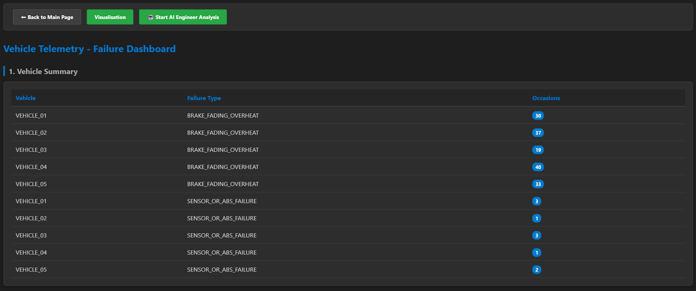
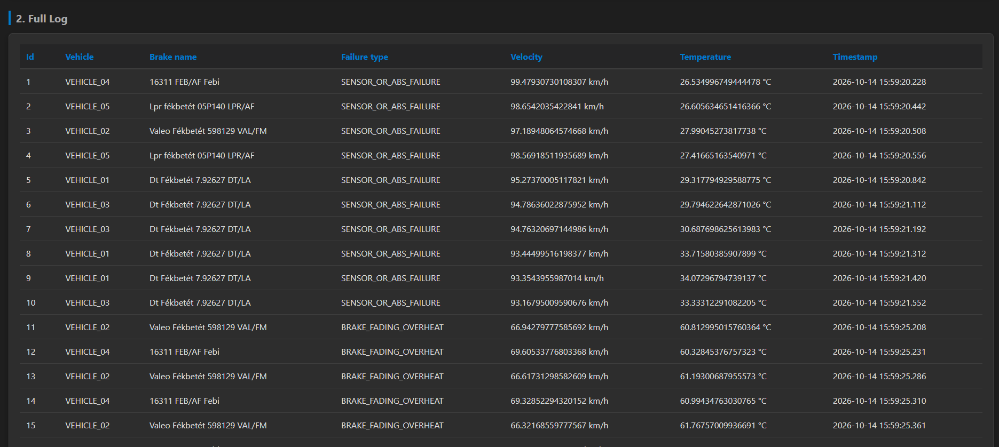

# Vehicle Telemetry & Fleet Management System

A real-time fleet monitoring and telemetry system that processes truck sensor logs, filters brake malfunctions, and leverages Google Gemini AI to generate engineering reports linking failure frequencies with component replacement costs.

## Technology Stack

The application logic is split into three independent nodes communicating via HTTP APIs:

- **C# .NET Web API Backend & MS SQL Server:** The core engine of the system. It processes incoming telemetry packets, saves data records using Entity Framework Core, and hosts the frontend views.
- **Python Telemetry Simulator & Web Scraper:** Simulates real-time truck activity on the highway and simultaneously scrapes live market prices for brake components, saving them to a shared JSON file.
- **Streamlit Python Dashboard:** A web-based analytical interface that fetches aggregated stats from the C# backend to display interactive charts.
- **Google Gemini AI Engine:** Integrated into the C# backend to analyze correlation models between replacement cost matrices and component failure counts.

## System Architecture & Logical Flow

The software operates through a straightforward pipeline:

- **Data Ingestion:** The Python simulator continuously pushes raw telemetry payloads to the C# API (`/vehicletelemetry/raw`), which processes and saves them into MS SQL Server tables.
- **State Filtering Logic (RAM Dictionary):** To track historical context without breaking database performance, the C# code maintains an in-memory Dictionary. This tracks the previous velocity of each specific truck, allowing the system to calculate sudden deceleration forces and distinguish a real brake failure from a faulty ABS sensor.
- **Aggregated Analytics:** The frontend interface calls the specialized summary endpoint (`/vehicletelemetry/failures`) to load and list real-time statistics.
- **AI-Powered Assessment:** When triggered, the backend bundles the failure metrics alongside the scraped component prices, sends the context to Gemini, and streams the clean engineering analysis directly to the browser.

## Engineering Challenges & Resolutions

- **Mitigating Database Bottlenecks:** High-frequency telemetry packets from the simulator initially caused database connection strain. This was solved by utilizing asynchronous programming (async/await) and optimizing Entity Framework configuration.
- **Correcting Graphing Overlaps in Python:** The original Matplotlib plot failed to render multiple data dimensions properly; if a vehicle had two distinct failure types, one overrode the other. This was fixed by switching to Streamlit and using the pandas `pivot()` function to group metrics side-by-side.
- **Handling Real-Time HTTP Connection Drops:** Because the Gemini model requires several seconds to generate a full technical breakdown, the browser often timed out. This was resolved by extending the HTTP keep-alive duration and configuring a 4-minute timeout limit via a JavaScript AbortController.

## User Interfaces & Dashboards

### 1. Main Management Gate
The central entryway hosted by the .NET server, allowing dispatchers to pick between reading raw telemetry streams or accessing live failure logs.

### 2. Live Aggregate Log
A data table reading structured metrics directly from SQL Server, displaying summarized failure counters alongside a long-form timestamp history.

### 3. Automated Engineering Report
The interface displaying text blocks processed by Gemini, bypassing raw JSON formatting through custom injection scripts.

### 4. Interactive Analytical Dashboard
The standalone Python web node handling structured analytics. Uses backend queries to map mechanical overheating alongside sensor issues without accuracy loss.
